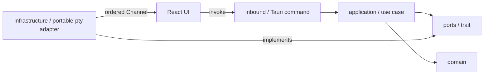
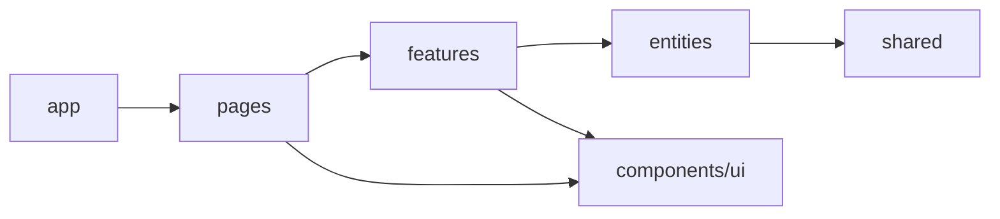

# tauri-xterm-pty

Tauri 데스크탑 앱에서 Rust PTY와 xterm.js를 연결하는 방법을 검증하기 위한 PoC입니다.
사용자의 기본 셸을 실제 PTY에서 실행하고, xterm.js의 키보드 입력·출력·창 크기를 Tauri IPC로
연결합니다. 셸 종료 후 재시작할 수 있으며 앱 창을 닫을 때 자식 프로세스를 정리합니다.

## 기술 스택

- [Tauri 2](https://tauri.app/), Rust 2024 edition, [portable-pty](https://docs.rs/portable-pty/)
- React 19, TypeScript, Vite 7
- [shadcn/ui](https://ui.shadcn.com/)와 Tailwind CSS 4
- [xterm.js](https://xtermjs.org/), FitAddon, Unicode11Addon, WebglAddon
- Vitest, Testing Library, Rust unit test

## 실행

Node.js, npm, Rust와 [Tauri의 운영체제별 사전 요구 사항](https://tauri.app/start/prerequisites/)이
필요합니다.

```bash
npm install
npm run tauri:dev
```

브라우저에서 프런트엔드만 확인할 때는 다음 명령을 사용합니다. 이 경우 Tauri IPC를 사용할 수
없으므로 Runtime probe가 `Unavailable`로 표시되는 것이 정상입니다.

```bash
npm run dev
```

## 검증 명령

```bash
npm run check-types
npm test
npm run build
cargo test --manifest-path src-tauri/Cargo.toml
npm run tauri build -- --debug --no-bundle
```

## 아키텍처

Rust 영역은 헥사고날 아키텍처를 사용합니다. Tauri command는 inbound adapter이며 application
service에만 위임합니다. `portable-pty`와 Tauri Channel은 outbound port 뒤의 infrastructure
adapter에 둡니다.



React 영역은 Feature-Sliced Design을 사용합니다. 상위 레이어는 하위 레이어만 의존하며,
shadcn/ui registry 컴포넌트는 참조 프로젝트와 동일하게 `components/ui`에 보관합니다.



주요 디렉터리 역할은 다음과 같습니다.

- `src/app` — 앱 진입점과 전역 조합
- `src/pages` — 화면 단위 UI
- `src/features` — 터미널 세션과 같은 사용자 상호작용
- `src/entities` — 터미널 도메인 타입, API adapter, 모델 로직
- `src/components/ui` — shadcn/ui 생성 컴포넌트
- `src-tauri/src/domain` — 순수 Rust 도메인 모델
- `src-tauri/src/application` — 유스케이스와 비즈니스 흐름
- `src-tauri/src/ports` — outbound port trait
- `src-tauri/src/inbound` — Tauri command adapter
- `src-tauri/src/infrastructure` — 운영체제 및 `portable-pty` 기반 PTY adapter

## 현재 구현

- [x] Tauri 2 + React + TypeScript 스캐폴드
- [x] shadcn/ui + Tailwind CSS 4 설정
- [x] xterm.js 대화형 터미널과 창 크기 대응
- [x] WebGL2 가속 렌더링
- [x] FSD 프런트엔드 레이어
- [x] 헥사고날 Rust 레이어
- [x] 기본 셸, 플랫폼, 아키텍처, 작업 디렉터리 조회 command
- [x] Rust PTY 세션 생성과 종료
- [x] PTY 출력의 세션별 Tauri Channel 스트리밍
- [x] 키보드 입력과 resize command 연결
- [x] 셸 재시작과 앱 종료 시 자식 프로세스 정리

## 보안 원칙

로컬 셸을 실행하는 앱이므로 Tauri capability와 command 표면을 최소화합니다. 프런트엔드에
범용 명령 실행 API를 노출하지 않고, UUID 세션 식별자와 터미널 크기, 입력 payload를
검증하며, 앱 종료 시 PTY와 자식 프로세스를 명시적으로 정리합니다.

## 라이선스

라이선스는 아직 정해지지 않았습니다.
