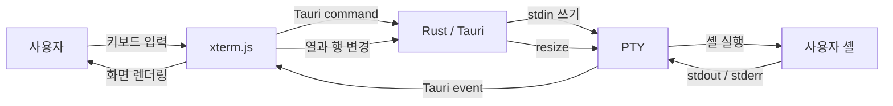

# tauri-xterm-pty

Tauri 데스크탑 앱에서 Rust로 PTY(의사 터미널)를 생성하고, 웹뷰의
[xterm.js](https://xtermjs.org/)와 연결하는 방법을 검증하기 위한 PoC입니다.

> 현재 저장소는 초기 설계 단계입니다. 애플리케이션 소스와 빌드 설정은 아직 추가되지 않았습니다.

## 목표

- Rust에서 사용자의 기본 셸을 PTY로 실행합니다.
- PTY 출력을 Tauri 이벤트를 통해 프런트엔드로 전달합니다.
- xterm.js의 키보드 입력과 터미널 크기 변경을 Rust PTY에 반영합니다.
- 프로세스 종료 및 앱 창 종료 시 관련 리소스를 안전하게 정리합니다.

## 아키텍처

## 예정 기술 스택

- [Tauri](https://tauri.app/) — 데스크탑 애플리케이션 셸과 Rust/웹뷰 브리지
- [Rust](https://www.rust-lang.org/) — PTY 및 자식 프로세스 생명주기 관리
- [xterm.js](https://xtermjs.org/) — 브라우저 기반 터미널 UI
- TypeScript — 프런트엔드 이벤트 및 터미널 상태 관리

PTY 구현에 사용할 Rust crate와 프런트엔드 프레임워크는 구현 과정에서 확정합니다.

## PoC 범위

### 포함

- 단일 터미널 세션 생성 및 종료
- 셸 입출력 스트리밍
- 터미널 크기 변경
- 기본 ANSI escape sequence 렌더링
- 앱 종료 시 PTY와 자식 프로세스 정리

### 제외

- 다중 탭 및 세션 복원
- SSH 연결
- 터미널 프로필과 테마 편집 UI
- 셸 기록 동기화
- 배포용 코드 서명과 자동 업데이트

## 완료 기준

다음 시나리오가 데스크탑 앱에서 정상 동작하면 PoC가 완료된 것으로 봅니다.

1. 앱을 실행하면 사용자의 기본 셸 프롬프트가 표시됩니다.
2. `pwd`, `ls`와 같은 대화형 명령을 입력하고 결과를 확인할 수 있습니다.
3. `vim`처럼 전체 화면을 사용하는 TUI 프로그램을 실행할 수 있습니다.
4. 창 크기를 바꾸면 PTY의 행과 열 크기가 함께 변경됩니다.
5. 셸 또는 앱을 종료해도 고아 프로세스가 남지 않습니다.

## 개발 환경 및 실행

구현을 시작하려면 먼저 [Tauri의 사전 요구 사항](https://tauri.app/start/prerequisites/)에
따라 Rust, Node.js와 운영체제별 빌드 도구를 준비해야 합니다.

프로젝트 스캐폴딩과 패키지 스크립트가 추가되면 설치 및 실행 명령을 이 절에 문서화합니다.

## 보안 고려 사항

이 앱은 로컬 셸을 직접 실행하므로 프런트엔드에서 호출할 수 있는 Tauri command를 최소화해야
합니다. 임의 명령 실행 API를 노출하지 않고, 세션 식별자 검증과 이벤트 권한을 명시적으로
관리하는 것을 기본 원칙으로 합니다.

## 라이선스

라이선스는 아직 정해지지 않았습니다.
