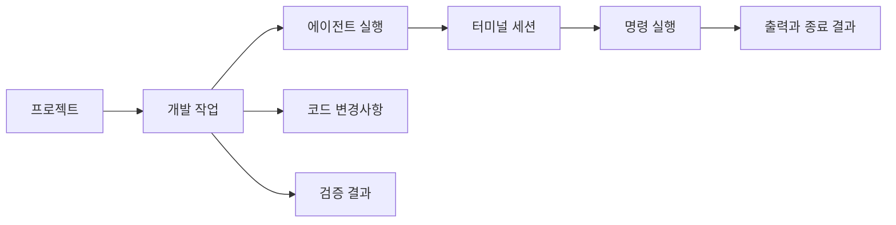

# 에이전트 개발 IDE를 위한 기능 조사와 Code OSS 터미널 비교

- 조사일: 2026-10-13
- 대상: `tauri-xterm-pty`의 현재 구현
- 비교 대상: 로컬 `/Users/yoophi/project/code-oss` 체크아웃, 커밋 `25a1c69926c`
- 조사 방법: 소스 코드, 기능 등록 코드, 설정, 테스트 코드 및 README 정적 확인
- 검증 범위: 앱 실행, 테스트 실행, 운영체제별 동작 및 배포판의 실제 기능 활성화 여부는 검증하지 않았다.

## 현재 구현과 평가 기준

현재 프로젝트는 Tauri와 Rust PTY를 xterm.js에 연결하는 단일 터미널 PoC다. 사용자가 셸에서
에이전트 CLI를 직접 실행할 기반은 있지만, 프로젝트와 에이전트 작업을 관리하는 IDE 기능은
아직 없다.

평가 기준은 CLI 에이전트를 실행하고, 사용자가 IDE에서 작업 상태와 변경사항을 검토하는
제품이다. Code OSS의 모든 기능을 그대로 구현하는 것을 목표로 하지 않는다. 터미널의 기본
사용성, 에이전트 작업 관찰, 실행 안정성을 먼저 확보하는 방향으로 우선순위를 제안한다.

Code OSS 열의 ‘있음’은 해당 체크아웃에서 구현과 등록 경로를 확인했다는 뜻이다. 원격 환경,
셸 종류, 설정, 모델 공급자, 운영체제 및 실험 기능 여부에 따라 실제 사용 가능성은 달라진다.
특히 채팅과 에이전트 도구 코드를 포함한다고 해서 모든 Code OSS 배포판에서 곧바로 AI 기능을
사용할 수 있다는 의미는 아니다.

## 확보된 기반

- 실제 PTY에서 기본 셸 실행
- 키보드 입력 전달, 세션별 출력 스트리밍, 터미널 크기 변경
- xterm.js, FitAddon, Unicode11Addon, WebGL 렌더러와 fallback
- 10,000줄 scrollback과 고정 글꼴·색상 설정
- UUID 세션 식별자, 터미널 크기, 입력 크기 검증
- 셸 프로세스 종료와 오류 이벤트 표시
- 컴포넌트 해제 및 앱 창 종료 시 세션 종료 요청
- Rust의 세션별 레지스트리, FSD 프런트엔드와 헥사고날 Rust 구조
- 도메인·서비스 단위 테스트 및 실제 PTY 출력·종료 테스트 코드

주요 근거:

- [터미널 화면과 이벤트 처리](../src/features/terminal-session/ui/terminal-surface.tsx)
- [터미널 옵션](../src/features/terminal-session/model/terminal-options.ts)
- [터미널 API](../src/entities/terminal/api/terminal-api.ts)
- [PTY 세션 구현](../src-tauri/src/infrastructure/portable_pty_session_adapter.rs)
- [앱 종료 처리](../src-tauri/src/lib.rs)

## Code OSS 터미널 기능 비교표

표의 현재 상태는 ‘있음’, ‘부분’, ‘없음’으로 구분한다. ‘부분’은 기초 구현은 있지만 Code OSS와
비슷한 제품 기능으로 제공하려면 추가 작업이 필요하다는 뜻이다. P0는 초기 제품 핵심,
P1은 일상적인 개발에 필요한 기능, P2는 확장 단계다. 우선순위는 이 프로젝트에 대한 제안이다.

| 기능 | Code OSS | 현재 프로젝트 | 차이 및 필요한 작업 | 우선순위 |
|---|---|---|---|---|
| 로컬 대화형 PTY | 있음 | 있음 | 현재 핵심 기반을 유지한다. 운영체제별 검증은 별도로 필요하다. | 기반 |
| 터미널 크기 변경 | 있음 | 있음 | 현재 FitAddon과 resize IPC가 연결되어 있다. | 기반 |
| GPU 렌더링·유니코드 폭 처리 | 있음 | 부분 | WebGL fallback과 Unicode 11은 있다. 렌더러·유니코드 설정 UI는 없다. | P2 |
| scrollback | 있음 | 부분 | 현재 10,000줄 고정이다. 사용자 설정과 기록 저장은 없다. | P1 |
| 셸 프로필·기본 프로필 선택 | 있음 | 없음 | 실행 파일, 인자, 환경변수, 프로필 선택을 제공한다. | P0 |
| 작업 디렉터리 지정 | 있음 | 부분 | 앱 프로세스의 현재 디렉터리를 사용한다. 프로젝트와 세션별 cwd를 지정해야 한다. | P0 |
| 터미널 생성·탭·전환 | 있음 | 부분 | 백엔드에는 세션 레지스트리가 있지만 UI는 터미널 하나다. 세션 목록과 조작 UI가 필요하다. | P0 |
| 분할 화면·분할 크기 조절 | 있음 | 없음 | 여러 에이전트와 개발 서버를 동시에 관찰할 수 있게 한다. | P1 |
| 이름·아이콘·색상·상태 표시 | 있음 | 없음 | 프로젝트, 작업, 실행 주체를 터미널에서 식별할 수 있게 한다. | P1 |
| 터미널 재실행·닫기 | 있음 | 부분 | 종료 API와 자동 정리는 있다. 사용자 재시작·닫기 UI는 없다. | P0 |
| 터미널 출력 검색 | 있음 | 없음 | 검색 UI와 SearchAddon을 연결하고 정규식·대소문자·단어 검색을 제공한다. | P1 |
| URL·파일 경로·행 번호 링크 | 있음 | 없음 | 출력에서 브라우저 또는 파일의 해당 위치를 열 수 있게 한다. | P1 |
| 복사·붙여넣기 UX | 있음 | 부분 | xterm 기본 입력·선택 기반은 있다. 앱 수준 메뉴·단축키·다중 줄 붙여넣기 확인은 없다. | P1 |
| 글꼴·테마·확대·축소 설정 | 있음 | 부분 | 현재 글꼴과 테마를 코드에서 고정한다. 사용자 설정과 확대·축소 명령이 필요하다. | P1 |
| 셸 통합 | 있음 | 없음 | 셸 시작 스크립트와 escape sequence 처리를 연결해 명령·cwd를 추적한다. | P0 |
| 명령별 시작·완료·exit code | 있음 | 없음 | 현재는 셸 프로세스 종료만 감지한다. 셸 내부의 개별 명령 결과를 구분해야 한다. | P0 |
| 명령·디렉터리 이력 | 있음 | 없음 | 셸 자체 이력과 별도로 IDE에서 조회·재실행하는 기능이 필요하다. | P1 |
| 명령 단위 탐색·선택·장식 | 있음 | 없음 | 이전·다음 명령 이동, 명령 출력 선택, 성공·실패 표시를 제공한다. | P1 |
| Sticky Scroll | 있음 | 없음 | 긴 출력에서도 실행한 명령을 확인할 수 있게 한다. 셸 통합 이후 확장한다. | P2 |
| 명령 제안·자동완성·Quick Fix | 있음 | 없음 | 셸의 기본 완성과 별개인 IDE 제안 UI 및 실패 명령 수정 기능이 없다. | P2 |
| 세션 재연결·버퍼 복원 | 있음 | 없음 | 현재 화면 해제 시 종료 요청을 보낸다. UI 수명과 세션 수명을 분리해야 한다. | P1 |
| 원격 터미널 백엔드 | 있음 | 없음 | 현재 로컬 PTY만 지원한다. 원격 전송·인증·재연결이 필요하다. | P2 |
| PTY 출력 흐름 제어 | 있음 | 없음 | Code OSS는 소비 ACK와 watermark에 따라 PTY를 pause/resume한다. 현재에는 명시적인 소비량 기반 제어가 없다. | P1 |
| 출력 버퍼 직렬화 | 있음 | 없음 | 화면 표시와 기록 저장을 분리하고 복원용 버퍼를 관리한다. | P1 |
| 접근성 전용 출력 뷰 | 있음 | 부분 | 현재 region 레이블은 있다. 스크린리더용 출력 뷰와 탐색 기능은 없다. | P1 |
| 터미널 알림·시각적 bell | 있음 | 없음 | 앱 수준 알림 정책과 세션 상태 표시가 없다. | P1 |
| 선택 코드·현재 파일 실행 | 있음 | 없음 | 편집기 또는 외부 편집기와 터미널 실행을 연결한다. | P2 |
| Task 실행 연동 | 있음 | 없음 | 테스트·빌드 실행을 작업과 연결하고 결과를 수집한다. | P1 |
| 에이전트 명령 실행 도구 | 있음 | 없음 | UI 입력 IPC와 별도로 실행 ID·결과·취소를 가진 도구 인터페이스가 필요하다. | P0* |
| 에이전트 출력 조회·추가 입력·종료 | 있음 | 없음 | 실행별 출력 조회, 대화형 입력 전달, 종료 도구를 제공한다. | P0* |
| 에이전트 승인·자동 승인·sandbox | 있음 | 없음 | 도구 명령 승인과 격리 정책을 제공하거나 외부 CLI의 정책을 연결한다. | P0 |
| 에이전트 출력 압축·캐시 | 있음 | 없음 | 긴 출력의 컨텍스트 사용량을 제어하고 실행별 결과를 관리한다. | P1* |
| 터미널 채팅·선택 내용 전달 | 있음 | 없음 | 선택 출력과 마지막 명령을 에이전트 대화에 전달하는 흐름이 필요하다. | P1 |
| 터미널을 편집기 영역·다른 창으로 이동 | 있음 | 없음 | 세션과 화면을 분리한 뒤 도입할 수 있다. | P2 |
| 이미지·폰트 합자 렌더링 | 있음 | 없음 | 별도 xterm addon을 사용한다. 초기 에이전트 개발 흐름의 우선순위는 낮다. | P2 |

`P0*`, `P1*`는 IDE 자체가 에이전트의 도구 실행을 담당할 때의 우선순위다. 외부 CLI를
호스팅하는 초기 제품이라면 CLI가 수행하는 도구 실행·출력 압축을 중복 구현하기보다 실행
프로필, 상태 관찰, 승인 연결, 대화 재개를 먼저 제공할 수 있다.

프로세스 유지와 복원은 구분해야 한다. 창 reload 후 살아 있는 프로세스에 재연결하는 것,
앱 재시작 후 버퍼를 복원하는 것, 종료된 프로세스를 새로 실행하는 것은 서로 다른 동작이다.
Code OSS의 복원 구현이 임의의 프로세스 실행 상태를 완전히 되살린다는 의미는 아니다.

## Code OSS 구현 근거

아래 경로는 비교 대상 저장소 루트 기준이다. 이 문서를 다른 환경에서 읽는 경우 해당 커밋의
소스를 확인한다.

| 비교 영역 | 확인한 소스 | 확인 내용 |
|---|---|---|
| 기능 등록 | `src/vs/workbench/contrib/terminal/terminal.all.ts` | 검색, 이력, 링크, 접근성, Quick Fix, 제안, 알림, 채팅, 에이전트 도구 등의 contribution 등록 |
| 터미널 조작 | `src/vs/workbench/contrib/terminal/browser/terminalActions.ts` | 생성, 탭 포커스, 분할, 이름 변경, 재실행, 명령 탐색, 세션 attach/detach, 편집기 이동 명령 |
| 프로필 | `src/vs/platform/terminal/common/terminalPlatformConfiguration.ts` | 운영체제별 프로필, 실행 인자, 환경변수, 기본 프로필 설정 |
| 터미널 설정 | `src/vs/workbench/contrib/terminal/common/terminalConfiguration.ts` | cwd, scrollback, 렌더링, 복사·우클릭 동작, 지속 세션, 셸 통합 설정 |
| xterm 확장 | `src/vs/workbench/contrib/terminal/browser/xterm/xtermTerminal.ts` | SearchAddon, SerializeAddon, ShellIntegrationAddon, WebglAddon, ImageAddon, LigaturesAddon 연결 |
| 명령 추적 | `src/vs/platform/terminal/common/capabilities/commandDetectionCapability.ts` | 명령 실행·완료 이벤트, cwd, 명령별 exit code |
| 셸 통합 프로토콜 | `src/vs/platform/terminal/common/xterm/shellIntegrationAddon.ts` | 터미널 escape sequence를 셸 상태·명령 추적 capability로 연결 |
| 세션 복원 | `src/vs/workbench/contrib/terminal/electron-browser/localTerminalBackend.ts` | 터미널 상태 저장, 역직렬화, 프로세스 revive 경로 |
| 프로세스 관리 | `src/vs/workbench/contrib/terminal/browser/terminalProcessManager.ts` | 지속 세션 조건, 재연결 속성, 출력 ACK 전달 |
| 출력 흐름 제어 | `src/vs/platform/terminal/node/terminalProcess.ts` | 미확인 출력량의 high/low watermark에 따른 PTY pause/resume |
| 원격 연결 | `src/vs/workbench/contrib/terminal/browser/remoteTerminalBackend.ts` | remote authority에 연결된 터미널 백엔드 |
| 출력 검색 | `src/vs/workbench/contrib/terminalContrib/find/browser/terminal.find.contribution.ts` | 검색 UI, 정규식·단어·대소문자 옵션 명령 |
| 붙여넣기 확인 | `src/vs/workbench/contrib/terminalContrib/clipboard/browser/terminalClipboard.ts` | bracketed paste 지원 여부 등을 고려한 다중 줄 붙여넣기 확인 |
| 링크 | `src/vs/workbench/contrib/terminalContrib/links/browser/terminalLinkManager.ts` | 파일·URL 등 링크 탐지와 열기 연결 |
| 접근성 | `src/vs/workbench/contrib/terminalContrib/accessibility/browser/terminal.accessibility.contribution.ts` | 접근성 출력 뷰와 탐색 연결 |
| 에이전트 도구 등록 | `src/vs/workbench/contrib/terminalContrib/chatAgentTools/browser/terminal.chatAgentTools.contribution.ts` | 명령 실행, 출력 조회, 입력 전달, 종료, 선택·최근 명령 조회, Task 도구 등록 |
| 에이전트 명령 실행 | `src/vs/workbench/contrib/terminalContrib/chatAgentTools/browser/tools/runInTerminalTool.ts` | 명령 실행 결과, exit code, 백그라운드 실행, 승인·sandbox 연결 |
| 에이전트 출력 조회 | `src/vs/workbench/contrib/terminalContrib/chatAgentTools/browser/tools/getTerminalOutputTool.ts` | 실행 UUID 기반 출력 조회와 출력 snapshot 관리 |
| 에이전트 실행 정책 | `src/vs/workbench/contrib/terminalContrib/chatAgentTools/common/terminalChatAgentToolsConfiguration.ts` | 명령 패턴별 승인 설정과 sandbox 관련 설정 |

일반 터미널 프로필과 agent host 프로필은 지원 범위가 다르다. 조사한 체크아웃의 설정 설명에
따르면 로컬 agent host 프로필은 현재 실행 파일 경로만 적용하고 인자·환경변수는 무시한다.
일반 터미널 프로필의 지원 범위를 agent host에 그대로 적용해서 해석하면 안 된다.

## 터미널을 넘어 IDE에 필요한 기능

다음 항목은 터미널 자체의 비교표와 별도로 에이전트 개발 IDE의 제품 흐름에 필요하다.

| 우선순위 | 부족 기능 | 필요한 동작 |
|---|---|---|
| P0 | 프로젝트 열기·전환 | 폴더 선택, 최근 프로젝트, 프로젝트별 설정 |
| P0 | 에이전트 실행 관리 | CLI 설치·인증 확인, 실행 프로필, 에이전트 대화 재개 |
| P0 | 에이전트 작업 상태 | 작업 중, 사용자 입력 대기, 승인 대기, 완료·실패 구분 |
| P0 | 변경사항 리뷰 | Git 상태·diff 확인, 선택적 되돌리기와 커밋 |
| P1 | 파일 탐색·코드 편집 | 파일 트리·검색·편집·저장·외부 변경 감지; 초기에는 외부 편집기 연동 가능 |
| P1 | 컨텍스트 전달 | 파일·선택 코드·diff·오류 로그 첨부와 전달 내용 확인 |
| P1 | 작업·대화 기록 | 프로젝트별 요청·계획·대화·결과 저장과 다시 열기 |
| P1 | Worktree 격리 | 작업별 브랜치·worktree 생성, 에이전트 연결, 충돌 확인과 정리 |
| P1 | 검증 실행·결과 수집 | 테스트·타입 검사·빌드 실행, 성공 여부와 실패 로그 연결 |
| P1 | 설정·진단 | PATH·환경변수·인증 문제 안내와 비밀값을 제외한 진단 로그 |
| P2 | 여러 에이전트 조정 | 역할별 작업 배정, 의존 관계, 결과 취합, 동일 파일 수정 충돌 확인 |
| P2 | 개발 서버 미리보기 | 서버 실행·종료, 포트 탐지, 미리보기와 브라우저 오류 전달 |
| P2 | 언어·디버깅 지원 | LSP 진단·정의 이동·자동완성, 디버거 연동 |
| P2 | 외부 연동 | 에이전트 어댑터, MCP 설정, 이슈·PR 연결 |
| P2 | 사용량 관리 | 에이전트가 제공하는 모델·토큰·비용 표시와 예산 설정 |
| P2 | 배포·유지보수 | 설치 패키지 검증, 서명·업데이트, 운영체제별 자동 검증 |

## 중요한 설계 차이

### 터미널 세션과 에이전트 작업을 분리해야 한다

현재 이벤트는 출력, 셸 프로세스 종료, 오류뿐이다. 셸이 살아 있는 동안 실행한 테스트나
에이전트 명령의 완료 여부는 구조화된 이벤트로 전달하지 않는다. 셸 프로세스의 exit code와
셸 내부에서 실행한 명령의 exit code는 다르다.

셸 통합은 개별 명령의 경계를 관찰하는 기반이다. 다만 에이전트 CLI가 계속 실행 중인 상태에서
한 요청을 완료하거나 승인을 기다리는 상태까지 셸 통합만으로 알 수 있는 것은 아니다.
에이전트 전용 이벤트·hook·프로토콜 어댑터가 필요하며, 단순 출력 문자열 추정은 보조 수단으로
제한하는 편이 좋다.

다음 관계를 관리하는 모델이 필요하다.

### 화면 해제와 프로세스 종료를 분리해야 한다

현재 `TerminalSurface`의 cleanup은 세션 종료를 요청한다. 탭 이동이나 레이아웃 변경에 따라
터미널 컴포넌트를 해제하면 작업까지 종료될 수 있는 구조다. 세션 소유권을 화면 밖의 관리
서비스로 옮기고, 화면은 세션에 연결하거나 분리하는 역할을 맡겨야 한다.

### IPC 검증과 에이전트 권한 정책은 다르다

UUID·입력 크기 검증은 IPC 요청의 유효성 검증이다. 실행한 셸이나 에이전트의 파일시스템·명령·
네트워크 접근을 제한하는 정책은 아니다. 외부 CLI를 호스팅할 때는 CLI의 권한 설정과 승인
요청을 연결하고, IDE가 명령을 직접 실행하는 경우에는 도구 계층에서 별도의 정책을 적용한다.

### 장시간 출력에 대한 흐름 제어가 필요하다

현재 PTY reader는 출력 조각을 Tauri Channel로 보내고 UI는 `terminal.write`에 전달한다.
렌더러가 처리한 출력량을 백엔드에 확인하는 경로는 없다. Code OSS의 ACK·watermark 방식을
참고해 큐 크기와 소비 속도를 제어하고, 표시용 버퍼와 저장용 로그의 정책을 구분해야 한다.
이 조사는 실제 메모리 증가나 출력 손실을 측정한 성능 진단은 아니다.

## 권장 구현 순서와 완료 기준

1. **프로젝트 선택·실행 프로필·다중 세션**
   - 선택한 프로젝트 cwd에서 지정한 셸 또는 에이전트를 실행할 수 있다.
   - 세션을 생성·전환·닫기·재시작할 수 있고, 화면 전환만으로 실행이 종료되지 않는다.
2. **셸 통합·에이전트 상태·승인 연결**
   - 개별 셸 명령의 시작·완료·exit code를 관찰한다.
   - 에이전트 작업 완료와 프로세스 종료를 구분하고 입력·승인 대기를 표시한다.
   - 작업 취소, 프로세스 재시작, 에이전트 대화 재개를 서로 다른 조작으로 제공한다.
3. **기록·출력 조회·흐름 제어**
   - 작업과 실행 ID로 로그를 찾고, 긴 출력에서도 UI와 큐 사용량을 제어한다.
   - 로그와 레이아웃 복원 범위, 실행 중 프로세스 유지 범위를 명시한다.
4. **Git diff·검증 결과·worktree**
   - 작업별 변경사항과 테스트 결과를 확인하고 반영하거나 되돌릴 수 있다.
5. **개발 편의 기능과 확장**
   - 검색·링크·복사·붙여넣기·접근성·알림을 보강한다.
   - 이후 편집기, 미리보기, 원격 터미널, 여러 에이전트 조정을 확장한다.

## 문서와 구현의 불일치

[README](../README.md)는 셸 종료 후 재시작할 수 있다고 설명하지만, 현재 화면에는 재시작
버튼이나 재시작 명령 연결이 없다. `start_terminal` API의 존재와 사용자가 재시작할 수 있는
제품 기능은 구분해야 한다.

## 후속 검증 항목

- 실제 터미널에서 복사·붙여넣기, IME, 한글·이모지 폭, TUI 및 Ctrl+C 동작 확인
- 여러 세션의 생성·종료·레이아웃 변경과 프로세스 수명 검증
- 장시간·대용량 출력의 렌더링 속도, 메모리, 큐 크기 측정
- 지원 셸별 셸 통합과 명령 exit code 추적 검증
- 에이전트별 입력 대기·승인 대기·작업 완료·대화 재개 검증
- 창 reload, 앱 종료·재시작, 비정상 종료 시 복원 정책 검증
- Windows·macOS·Linux의 셸 탐지와 자식 프로세스 정리 검증

이 항목들은 앞으로 구현에 맞춰 수행할 검증 목록이며 이번 정적 조사에서 실행한 테스트가
아니다.
